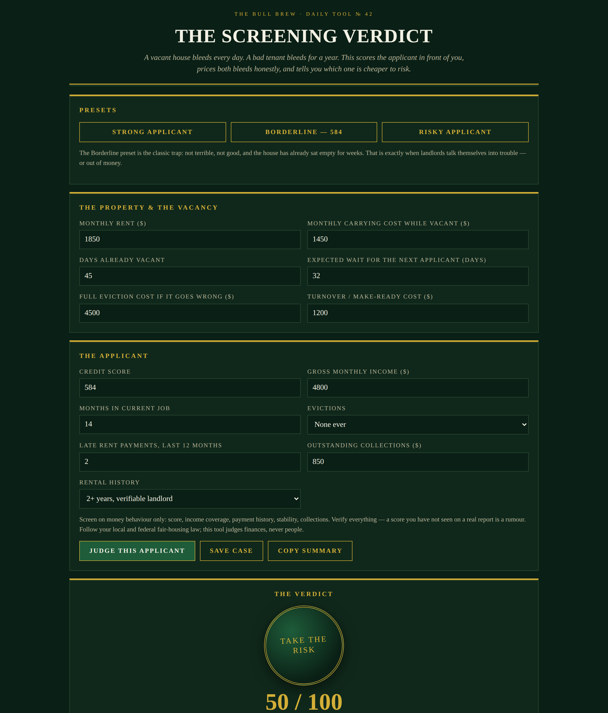

# The Screening Verdict — Tenant Applicant Judge

**Live:** https://thebullbrew.github.io/screening-verdict/
**Repo:** https://github.com/thebullbrew/screening-verdict

## What it does
A vacant house bleeds every day. A bad tenant bleeds for a year. This tool scores the rental applicant in front of you out of 100 — credit (35), income coverage (25), rental history (20), job stability (10), collections (10), each band interpolated rather than cliff-edged — converts that score into an estimated default risk, and prices it against the cost of passing and waiting for a stronger applicant.

You get a wax-seal verdict — APPROVE / CONDITIONAL / TAKE THE RISK / HOLD OUT / PASS — the cash bleed per vacant day, the sunk cost already burned, the break-even wait in days, a score-anatomy breakdown, a specific conditions list aimed at the applicant's exact weak spots (autopay, guarantor, deposit, verification steps), a 0–90 day wait sensitivity table, three presets including the classic Borderline 584 trap, saveable cases in your browser, and a copyable summary.

## The method behind it
Default risk is estimated from the score (about 3% at 90+, 9% at 70, 24% at 50, 48% at 30) and priced against one bad outcome: your eviction cost + 2.5 months of unpaid rent + turnover. Waiting is priced at the rent you forgo each day, plus the next applicant's smaller risk (modelled as a solid score-75 tenant). Money already burned while vacant is shown as sunk — it should sting, but it should not decide. Screening is on money behaviour only, with fair-housing and local-law caveats stated in the app.

## Design
Dark aesthetic variation 4 — Emerald Vault: deep emerald ground (#0A1F15), champagne gold (#D4AF37) hero numbers, malachite panels, cards with a top-edge gold light line, verdicts as circular wax-seal badges.

## How to run
Open `docs/index.html` in any browser, or serve the `docs/` folder with any static host. Works offline as a PWA after first load. No backend, no accounts, nothing leaves your browser.
